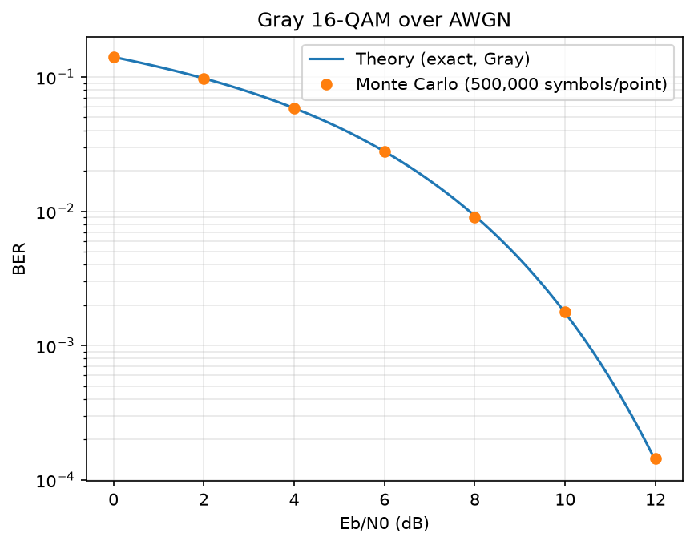

# 16-QAM BER over AWGN

Monte Carlo bit error rate (BER) of Gray-coded 16-QAM over an AWGN channel, compared with the exact theoretical BER.



## Method

- Gray 16-QAM built from two Gray-coded 4-PAM axes, normalized to Es = 1.
- Minimum-distance detection, vectorized with NumPy broadcasting (no loop over symbols).
- 500,000 symbols (2 million bits) per Eb/N0 point, seed 1.
- Theory: Pb = [3Q(d) + 2Q(3d) − Q(5d)] / 4, with d = √(0.8·Eb/N0). Same values as MATLAB `berawgn(EbNo, 'qam', 16)`.

## Results

| Eb/N0 (dB) | Bit errors | BER, simulated | BER, theory |
|---:|---:|---:|---:|
| 0 | 281,358 | 1.407e-01 | 1.410e-01 |
| 2 | 195,085 | 9.754e-02 | 9.774e-02 |
| 4 | 117,133 | 5.857e-02 | 5.862e-02 |
| 6 | 55,697 | 2.785e-02 | 2.787e-02 |
| 8 | 18,100 | 9.050e-03 | 9.247e-03 |
| 10 | 3,551 | 1.775e-03 | 1.754e-03 |
| 12 | 289 | 1.445e-04 | 1.387e-04 |

## Run

```bash
requirements.txt
python ber_16qam.py
```